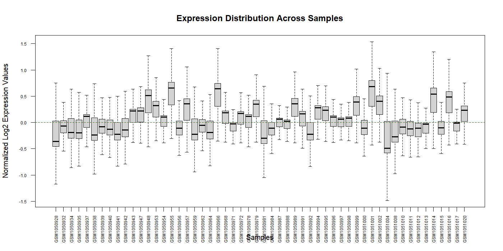
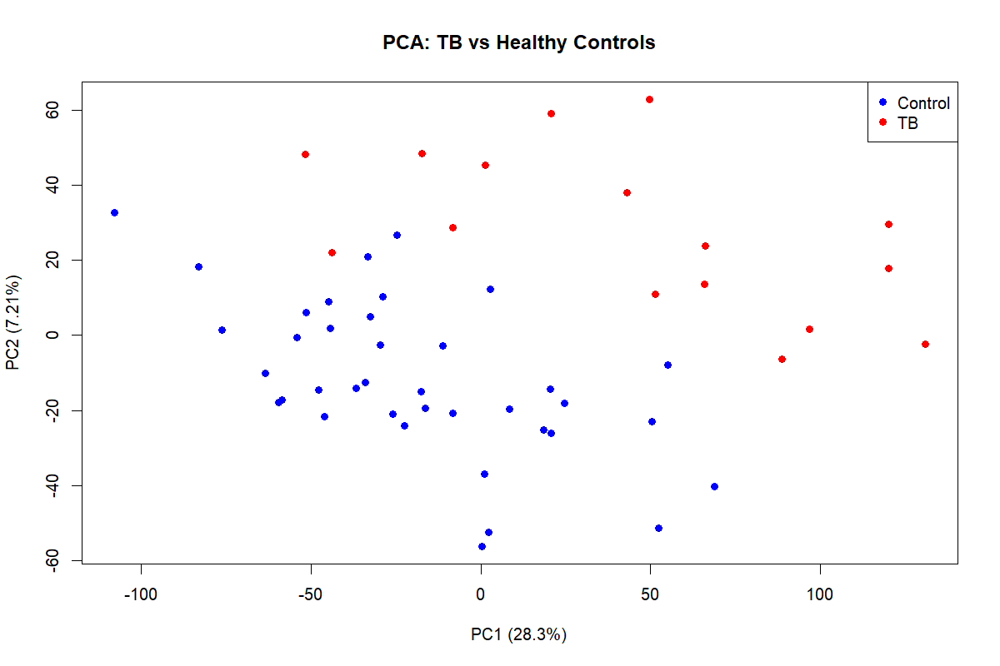
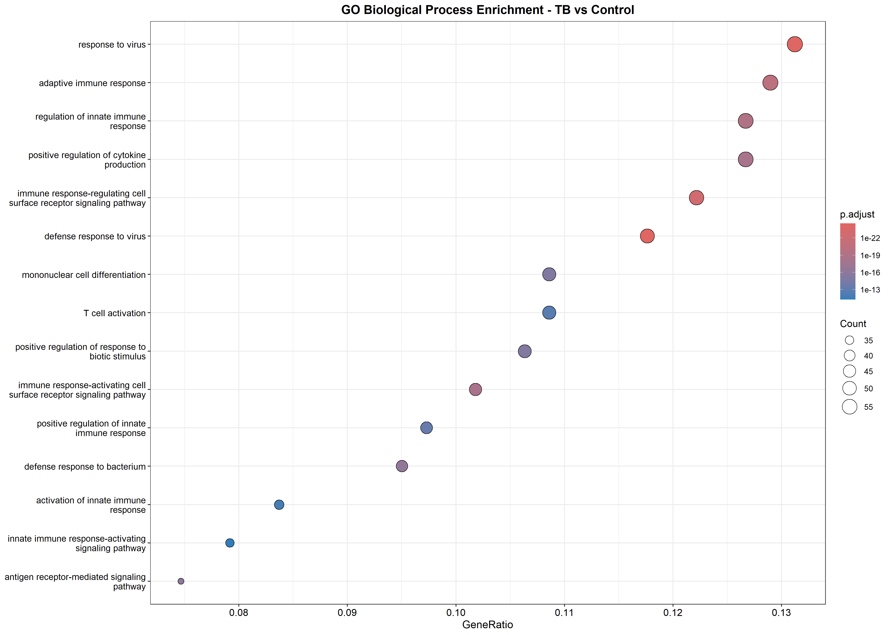
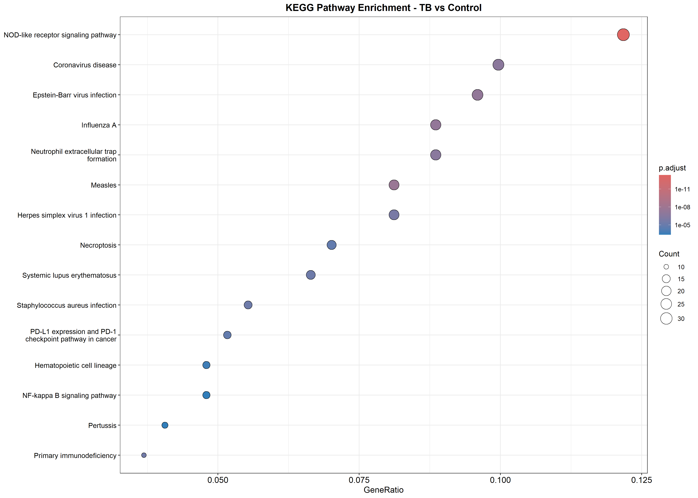
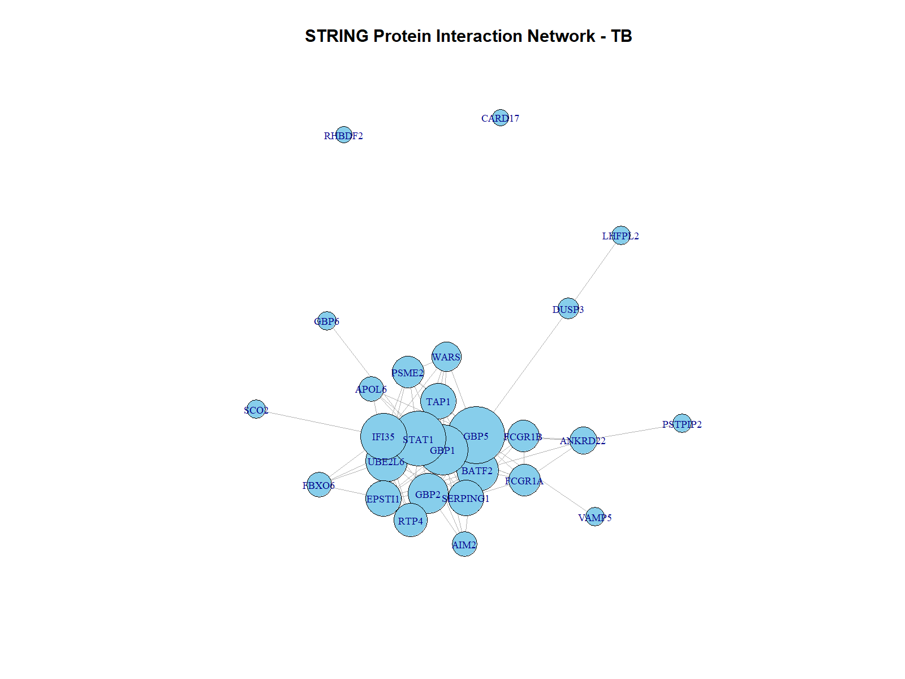

# Tuberculosis Gene Expression Analysis
## Abstract

Tuberculosis (TB) is an infectious disease that remains a major global public health concern. Understanding host gene expression changes associated with TB can provide insights into disease-related biological mechanisms and potential biomarkers. This project investigates differential gene expression between tuberculosis patients and healthy controls using the publicly available GSE42830 microarray dataset from the NCBI Gene Expression Omnibus (GEO).

The analysis was performed using R and Bioconductor packages. A total of 54 samples, including 16 TB samples and 38 healthy controls, were selected. Following data preprocessing and quality control, differential gene expression analysis was performed using the limma package, accounting for gender and ethnicity. The analysis identified 637 significant probes, including 442 upregulated and 195 downregulated probes. Gene annotation, Gene Ontology enrichment, KEGG pathway enrichment, and STRING protein interaction network analysis were also performed.

The findings provide an exploratory overview of TB-associated host gene expression patterns and biological pathways. Further validation is required before clinical application.

## 1. Introduction

### 1.1 Background

Tuberculosis (TB) is an infectious disease caused by *Mycobacterium tuberculosis*. It primarily affects the lungs and remains an important global public health challenge. Although TB can be diagnosed using microbiological and molecular tests, understanding the human immune response to infection is also important for studying disease mechanisms.

Gene expression analysis provides a way to investigate how genes behave under different biological conditions. Gene expression refers to the process through which information stored in genes is used to produce functional products, such as proteins. Changes in gene expression may indicate how the immune system responds to infection.

Microarray technology enables researchers to measure the expression levels of thousands of gene probes simultaneously. By comparing gene expression patterns between individuals with TB and healthy controls, researchers can identify genes that may be associated with the disease.

### 1.2 Problem Statement

Tuberculosis involves complex interactions between the pathogen and the human immune system. These interactions can produce changes in the expression of genes involved in immune responses, inflammation, and cellular signalling.

However, analyzing thousands of gene expression measurements manually is difficult. Bioinformatics methods are therefore required to identify statistically significant expression differences and interpret their biological relevance.

This project addresses the following research question:

**Which gene expression differences and biological pathways are associated with tuberculosis when comparing TB patients with healthy controls in the GSE42830 dataset?**

### 1.3 Project Aim

The main aim of this project is to identify and explore tuberculosis-associated gene expression patterns using publicly available microarray data and bioinformatics techniques implemented in R.

### 1.4 Objectives

1. Obtain and preprocess publicly available TB-related gene expression data from NCBI GEO.
2. Perform exploratory data analysis and quality control to understand the dataset.
3. Identify differentially expressed probes between TB patients and healthy controls using the limma package.
4. Annotate significant probes with corresponding gene identifiers.
5. Investigate enriched biological processes and pathways using GO and KEGG enrichment analysis.
6. Explore protein-protein interactions among selected TB-associated genes using STRING.
7. Interpret the findings and discuss their biological relevance and limitations.

### 1.5 Significance of the Study

This project demonstrates how publicly available biomedical datasets can be analyzed using reproducible bioinformatics workflows. Differential expression analysis helps identify candidate genes associated with tuberculosis, while functional enrichment analysis provides information about biological processes and pathways represented among these genes.

The project also demonstrates practical applications of R programming, statistical analysis, data visualization, and biological database integration in investigating a real-world health problem.

The results are intended for educational and exploratory research purposes rather than clinical diagnosis.

## 2. Dataset Description

### 2.1 Data Source

This project uses the publicly available **GSE42830** gene expression dataset obtained from the National Center for Biotechnology Information (NCBI) Gene Expression Omnibus (GEO).

The dataset contains human gene expression measurements collected using microarray technology. It includes samples representing different disease conditions, including tuberculosis, healthy controls, sarcoidosis, pneumonia, and lung cancer.

For this project, only tuberculosis and healthy control samples were selected to investigate TB-associated gene expression differences.

**Dataset information:**

| Property | Description |
|---|---|
| GEO accession | GSE42830 |
| Platform | GPL10558 |
| Data type | Microarray gene expression |
| Selected samples | 54 |
| Tuberculosis samples | 16 |
| Healthy control samples | 38 |
| Total probes | 47,323 |
| Analysis software | R and RStudio |

Dataset URL: https://www.ncbi.nlm.nih.gov/geo/query/acc.cgi?acc=GSE42830

### 2.2 Data Selection

The original dataset includes multiple disease categories. Samples labelled as tuberculosis (TB) and healthy controls were extracted using the sample metadata available through GEOquery.

A total of 54 samples were selected, including 16 TB samples and 38 healthy controls.

Gender and ethnicity information was also extracted from the sample metadata for use in the statistical analysis.

The selected samples included 31 females and 23 males. The recorded ethnicity categories included Caucasian (28), Afro-Caribbean (15), and Indian subcontinent (11).

### 2.3 Data Preprocessing

The gene expression matrix was imported into R and checked for missing values, infinite values, and duplicated probe identifiers.

The preprocessing checks confirmed:

- Missing expression values: 0
- Infinite expression values: 0
- Duplicate probe identifiers: 0
- Final expression matrix dimensions: 47,323 × 54

The expression matrix was retained for exploratory and statistical analysis.

### 2.4 Data Ethics

This project uses publicly available gene expression data from NCBI GEO. No new patient samples were collected. The dataset source is acknowledged through its GEO accession number.

## 3. Methodology

The analysis was performed in R using GEOquery, limma, clusterProfiler, STRINGdb, and other supporting packages.

### 3.1 Data Exploration

Expression boxplots were generated to inspect sample distributions. Principal Component Analysis (PCA) was used to explore variation between TB and healthy control samples.

### 3.2 Differential Expression Analysis

The limma package was used to compare TB and control samples. The statistical model included disease group, gender, and ethnicity.

The Benjamini–Hochberg method was used to adjust p-values for multiple testing. Probes were considered significant when the adjusted p-value was below 0.05 and the absolute log2 fold change exceeded 1.

### 3.3 Gene Annotation

Significant probes were mapped to gene symbols and Entrez Gene identifiers using microarray platform annotation.

### 3.4 Functional Enrichment

Gene Ontology Biological Process and KEGG pathway enrichment analyses were performed using clusterProfiler. A microarray-derived gene background was used for enrichment testing.

### 3.5 Protein Interaction Network

STRINGdb was used to retrieve protein associations for selected significant genes. The igraph package was used to examine and visualize the resulting interaction network.

## 4. Results

### 4.1 Dataset Quality Assessment

The final expression matrix contained 47,323 probes across 54 samples, consisting of 16 tuberculosis samples and 38 healthy controls.

Preprocessing checks identified no missing values, infinite values, or duplicated probe identifiers. Expression distribution boxplots were generated to examine the data, and Principal Component Analysis (PCA) was used to explore variation between samples.

*Figure 1. Gene expression distributions across the selected samples.*

*Figure 2. Principal Component Analysis of TB and healthy control samples.*

### 4.2 Differential Gene Expression Results

Differential expression analysis was performed using limma, with gender and ethnicity included as covariates.

A total of 637 probes satisfied the significance criteria, including 442 upregulated probes and 195 downregulated probes in the TB group relative to healthy controls.

| Measurement | Result |
|---|---:|
| Total tested probes | 47,323 |
| Significant probes | 637 |
| Upregulated probes | 442 |
| Downregulated probes | 195 |
| Annotated significant probes | 623 |
| Unique gene symbols | 537 |
| Unique Entrez IDs | 531 |

These findings indicate differences in host gene expression between the selected TB and control samples. However, the results represent statistical associations and do not establish that the identified genes cause tuberculosis.

### 4.3 Gene Annotation Results

Gene annotation linked 623 significant probes to gene information, producing 537 unique gene symbols and 531 unique Entrez identifiers.

Genes of interest identified during the analysis included BATF2, GBP5, ANKRD22, SERPING1, AIM2, GBP1, STAT1, and IFI35.

These genes are candidates for further biological investigation. Their specific expression statistics and potential roles require interpretation using the annotated DEG results and relevant literature.

### 4.4 Gene Ontology Enrichment Results

Gene Ontology Biological Process enrichment analysis identified 512 enriched terms in the saved final research summary.

The enrichment analysis was performed using significant genes and a microarray-derived background gene universe.

*Figure 3. GO Biological Process enrichment results.*

The enriched terms provide information about biological functions represented among the significant genes. The individual terms and their adjusted p-values should be examined before drawing conclusions about particular immune processes.

### 4.5 KEGG Pathway Enrichment Results

KEGG pathway enrichment analysis identified 44 enriched pathways in the final summary.

*Figure 4. KEGG pathway enrichment results.*

These pathways provide a functional overview of the gene expression changes associated with the selected TB samples. Enrichment does not independently establish that a pathway is activated or inhibited.

### 4.6 STRING Protein–Protein Interaction Network

The STRING protein interaction analysis produced a network containing 27 mapped proteins.

*Figure 5. STRING protein–protein interaction network.*

The network was used to explore functional associations between selected proteins. Highly connected proteins may be useful candidates for further investigation, although network connectivity alone does not demonstrate clinical biomarker value.
## 5. Discussion

The analysis of the GSE42830 dataset identified differences in gene expression between tuberculosis patients and healthy controls. Among 47,323 tested probes, 637 were identified as significantly differentially expressed, including 442 upregulated and 195 downregulated probes.

These findings suggest that tuberculosis is associated with measurable changes in host gene expression. The higher number of upregulated probes indicates that more probes met the positive fold-change threshold than the negative threshold in this selected dataset. However, this observation alone does not establish an overall increase in immune activity.

Several genes of interest, including BATF2, GBP5, STAT1, AIM2, and SERPING1, were identified for further investigation. These genes may be relevant to host immune responses, but their individual expression changes and biological functions should be interpreted alongside gene-level statistics and published evidence.

Gene Ontology enrichment analysis identified 512 enriched Biological Process terms, while KEGG analysis identified 44 enriched pathways. These analyses provide additional biological context by identifying functions and pathways overrepresented among the significant genes.

The STRING protein interaction network contained 27 mapped proteins. Network analysis can help identify relationships between selected proteins and highlight highly connected candidates for further investigation.

Together, these methods demonstrate how statistical analysis, functional annotation, and biological network exploration can be combined to investigate a biomedical research question using publicly available data.

## 6. Limitations

This project has several limitations.

First, the analysis included only 54 selected samples from GSE42830, with 16 tuberculosis samples and 38 healthy controls. The relatively small and unequal group sizes may affect statistical power and generalizability.

Second, the analysis was based on a single publicly available microarray dataset. Independent validation using another dataset was not performed, so the reproducibility of the identified expression patterns across populations and experimental platforms remains uncertain.

Third, microarray measurements provide indirect estimates of gene expression and may be affected by technical variation, probe annotation limitations, and other factors.

Fourth, although gender and ethnicity were included in the statistical model, additional biological or clinical variables may influence gene expression.

Finally, GO, KEGG, and STRING analyses depend on existing biological annotations and database information. Enrichment results and protein interaction networks should therefore be interpreted as exploratory findings rather than direct experimental confirmation.

## 7. Conclusion

This project investigated tuberculosis-associated host gene expression patterns using the publicly available GSE42830 microarray dataset and R-based bioinformatics methods.

Differential expression analysis identified 637 significant probes, including 442 upregulated and 195 downregulated probes. Gene annotation identified 537 unique gene symbols, while GO and KEGG enrichment analyses provided additional information about potentially relevant biological functions and pathways.

Protein interaction analysis further explored associations among selected proteins.

Overall, the project demonstrates a reproducible computational approach to analyzing biomedical gene expression data. The findings provide candidate genes and biological processes for future investigation but are not sufficient for clinical diagnosis or biomarker validation.

Future work could include independent dataset validation, additional statistical comparisons, and experimental confirmation of selected genes.

## 8. Reproducibility

The project was implemented using R and RStudio.

The main R packages include GEOquery, Biobase, limma, ggplot2, clusterProfiler, org.Hs.eg.db, enrichplot, STRINGdb, and igraph.

The project is organized into the following directories:

- `code/` — R scripts for the analysis workflow.
- `data/` — Input microarray data and downloaded GEO files.
- `results/` — Exported CSV results.
- `figures/` — Generated visualizations.

To reproduce the analysis, download the GSE42830 series matrix from NCBI GEO and place it in the `data/` directory.

Open the project in RStudio, install the required packages, and execute the numbered analysis scripts in the `code/` directory in the appropriate order.

The scripts generate the processed expression data, differential expression results, gene annotations, enrichment outputs, and network visualizations.

## 9. References

1. National Center for Biotechnology Information (NCBI). Gene Expression Omnibus: GSE42830. https://www.ncbi.nlm.nih.gov/geo/query/acc.cgi?acc=GSE42830

2. Ritchie, M. E., et al. (2015). limma powers differential expression analyses for RNA-sequencing and microarray studies. *Nucleic Acids Research*, 43(7), e47. https://doi.org/10.1093/nar/gkv007

3. Yu, G., Wang, L. G., Han, Y., & He, Q. Y. (2012). clusterProfiler: an R package for comparing biological themes among gene clusters. *OMICS*, 16(5), 284–287. https://doi.org/10.1089/omi.2011.0118

4. Szklarczyk, D., et al. (2023). The STRING database in 2023: protein–protein association networks and functional enrichment analyses for any sequenced genome of interest. *Nucleic Acids Research*, 51(D1), D638–D646. https://doi.org/10.1093/nar/gkac1000

5. R Core Team. R: A Language and Environment for Statistical Computing. R Foundation for Statistical Computing. https://www.r-project.org/
